# GÖGÖVERSE WEB

GÖGÖVERSE WEB; Kick, Discord, Instagram ve TikTok platformlarındaki yayın, etkinlik ve sosyal medya içeriklerini planlamak, takip etmek ve arşivlemek için geliştirilmiş bir web uygulamasıdır. Aylık yayın takvimi, içerik arşivi, yapılacak görevler (TODO) yönetimi ve platformlara özel Türkçe metin taslağı üretimi özelliklerini tek merkezde sunar; verileri tarayıcı `LocalStorage` alanında saklar.

## Kullanılan Teknolojiler ve Sürümler

| Teknoloji | Sürüm | Kullanım |
| --- | --- | --- |
| Angular | 22.2.6 | Web uygulaması çatısı (Standalone Components, Signals, Router, Reactive Forms) |
| Angular CLI | 22.2.7 | Proje geliştirme, derleme ve test altyapısı (`@angular/build`) |
| TypeScript | 6.0.3 | Tip güvenli uygulama mantığı |
| Bootstrap | 5.3.9 | Responsive arayüz ve ızgara (grid) sistemi |
| Vitest | 5.1.0 | Birim testleri (`@angular/build:unit-test` ve `jsdom`) |
| HTML5 & CSS3 | — | Semantik şablon yapısı ve özel koyu mor GÖGÖVERSE tema stilleri |
| Browser LocalStorage | — | İstemci tarafı kalıcı veri saklama |

## Kurulum ve Çalıştırma

> **Not:** Angular 22.2.x yapılandırması için Node.js `^22.22.3`, `^24.15.0` veya `>=26.0.0` sürümü önerilir.

Bağımlılıkları kurmak ve geliştirme sunucusunu başlatmak için:

```bash
npm ci
npm start
```

Uygulama varsayılan olarak `http://localhost:4200/` adresinde çalışır.

Production derlemesi (build) ve birim testlerini çalıştırmak için:

```bash
npm run build
npx ng test --watch=false
```

## Ekran Görüntüleri

### Ana Sayfa
İçerik istatistikleri, yaklaşan içerikler, platform dağılımı ve görev özetini tek ekranda sunar.
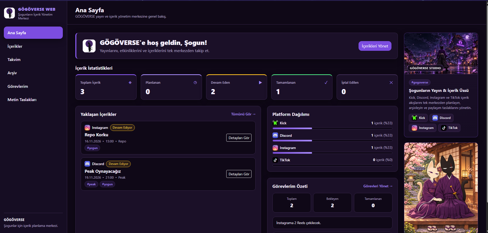

### İçerikler
Kayıtlı yayın, etkinlik ve sosyal medya içeriklerini arama, çoklu filtreleme ve sıralama seçenekleriyle listeler.
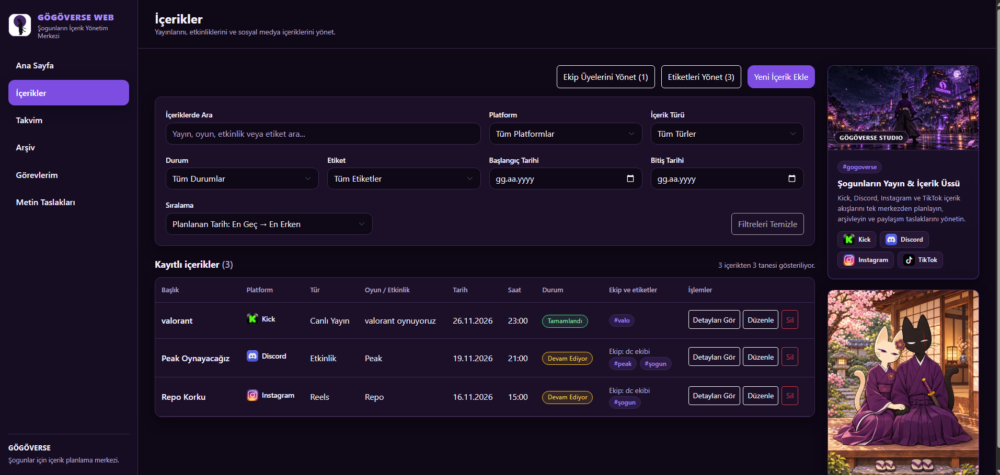

### Yeni İçerik Ekleme
Platform, içerik türü, tarih, hızlı saat seçimi, ekip üyeleri ve etiketlerle yeni içerik planlama formunu gösterir.
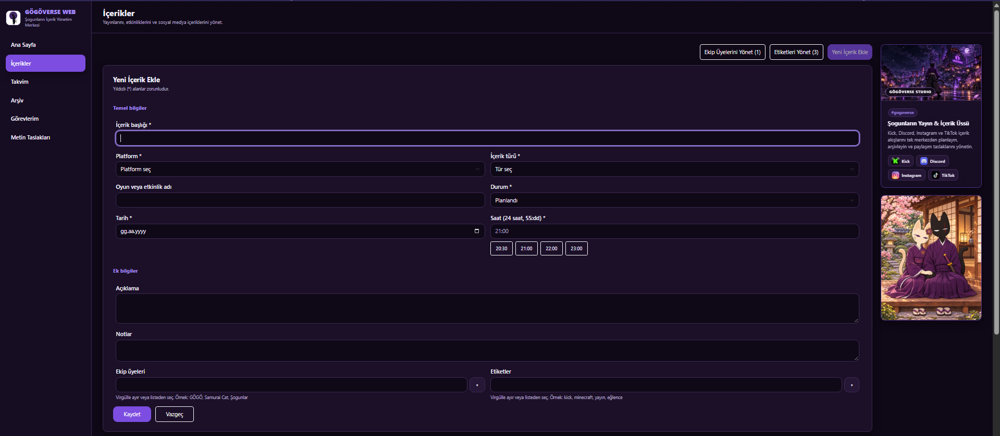

### İçerik Düzenleme
Mevcut bir içeriğin bilgilerini, durumunu, ekip üyelerini ve etiketlerini güncelleme ekranıdır.
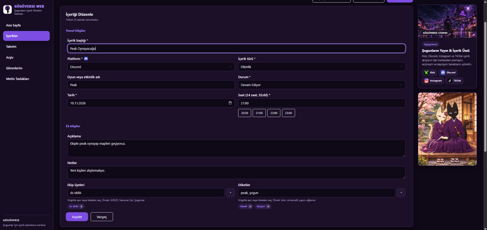

### İçerik Detayı
Seçilen içeriğin tüm planlama bilgilerini ve doğrudan metin taslağı oluşturma bağlantısını görüntüler.
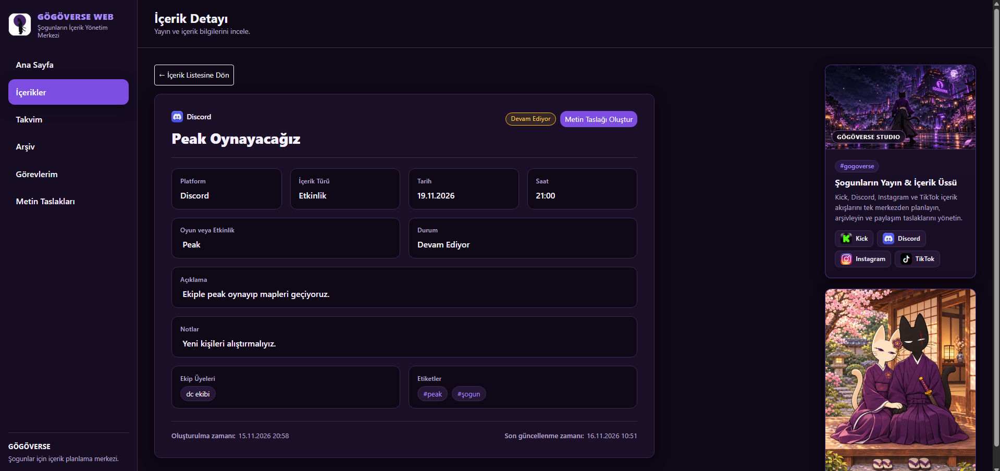

### Ekip ve Etiket Yönetimi
İçeriklerde kullanılan ekip üyelerini ve etiketleri kullanım sayılarıyla birlikte toplu olarak yönetmeyi sağlar.
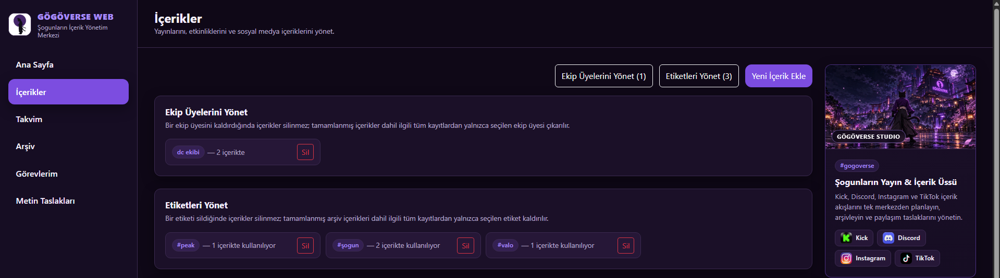

### Takvim
Pazartesi başlangıçlı aylık görünümde günlük içerik planlarını ve tamamlanan içeriklerin yeşil onay işaretlerini gösterir.
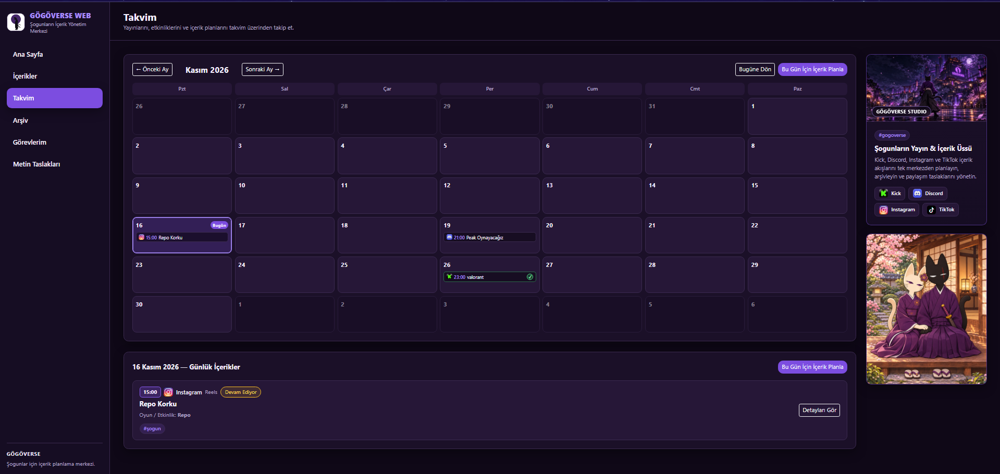

### İçerik Arşivi
Tamamlanan içeriklerin istatistiklerini, platform dağılımını ve eski kaydı koruyarak yeniden planlama özelliğini sunar.
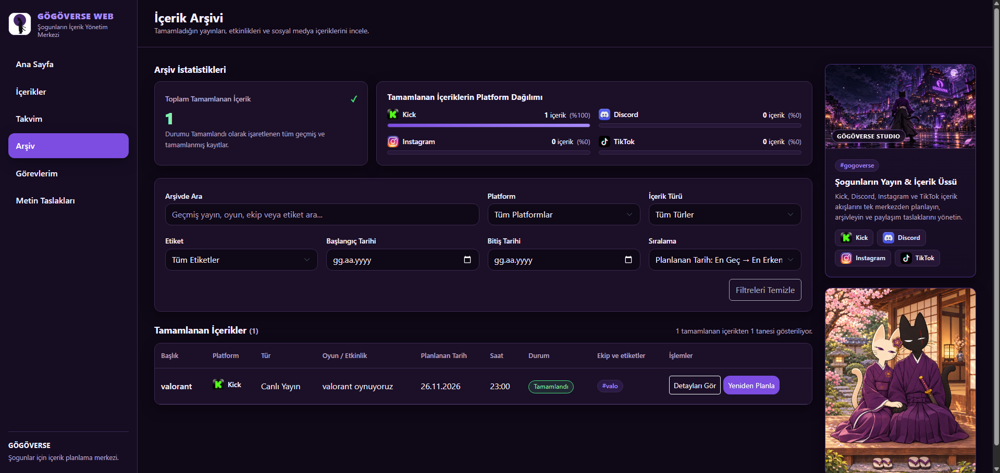

### Görevlerim
İçerik üretimi sürecindeki yapılacak işleri ekleme, filtreleme ve tamamlanma durumlarını takip etme ekranıdır.
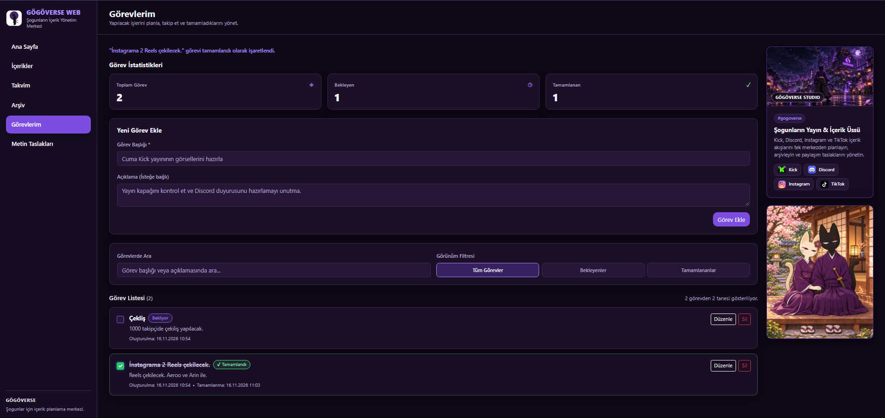

### Metin Taslakları — Şablon Oluşturma
Kayıtlı bir içerikten Kick, Discord, Instagram veya TikTok için hedef platforma uygun Türkçe taslak metin üretir.
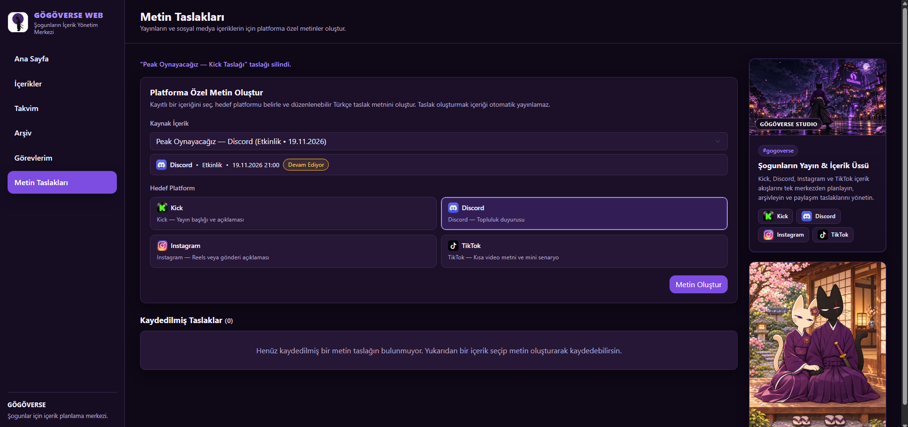

### Metin Taslakları — Düzenleme ve Kayıtlı Taslaklar
Oluşturulan taslak metinlerini düzenleme, tek tıkla kopyalama ve kaydedilmiş taslakları filtreleme görünümüdür.
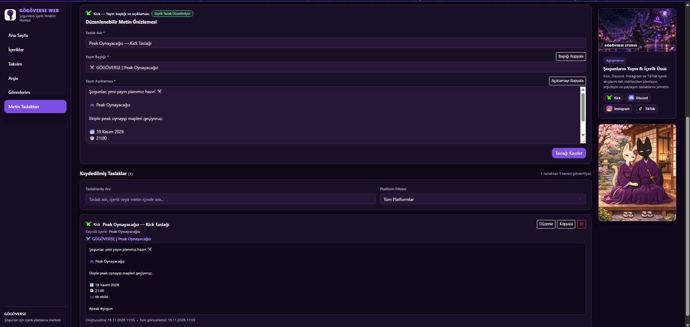
